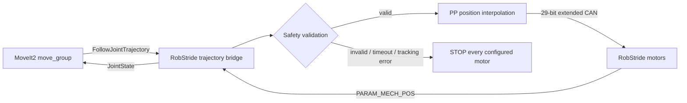

# MoveIt2 계획 궤적을 RobStride 실제 모터로 실행

작성일: 2026-09-04  
목적: Pallet MoveIt2가 생성한 `FollowJointTrajectory` 목표를 SocketCAN을 통해 실제 RobStride 모터에서 실행한다.

## 최종 기준 workspace

`/home/minwoo/Desktop/LLM/ros2_ur_ws`

## 실행 구조



주요 파일은 다음과 같다.

- `pallet_robstride_trajectory_bridge.py`: MoveIt action server, 보간 실행, 피드백, 중단 처리
- `robstride_trajectory_core.py`: CAN 프로토콜, 좌표 변환, 설정 및 궤적 검증
- `robstride_hardware.yaml`: 모터 ID, 방향, 영점, 관절 한계, 전류·속도·가속도 제한
- `robstride_demo.launch.py`: fake controller 없이 robot state, bridge, move_group, RViz 실행

## 안전 설계 결정

실제 실행은 설정의 `commissioned: true` 없이는 시작되지 않는다. Arm 관절은 `j1→ID 1`부터 `j5→ID 5`까지 대응하고, ID 6과 7은 향후 그리퍼용으로 예약한다. 방향 `1`과 영점 `0.0`은 아직 실측값이 아니므로 검증하기 전 `dry_run:=false`를 사용하면 안 된다.

브리지는 다음 조건에서 goal을 거부하거나 모든 설정 모터에 STOP을 보낸다.

- 관절 이름, 점 개수, 시간 또는 숫자 형식 오류
- URDF 기반 위치 한계 또는 운용 속도 한계 초과
- 첫 trajectory point와 실측 자세 차이가 `max_start_error_rad` 초과
- 모터 피드백 누락, CAN 오류, 추종 오차 또는 최종 오차 초과
- action cancel 또는 노드 종료

모터 enable 전에 실측 현재 위치를 `LOC_REF`로 기록해 이전 목표값으로 점프하는 것을 막는다.

## 실행 순서

터미널 1에서 먼저 CAN과 모터 응답을 읽기 전용으로 확인한다.

```bash
cd /home/minwoo/Desktop/LLM
pallet_can
python3 robstride_read_angles.py --motor 1 2 3 4 5 --once
```

팔을 지지하고 각 축을 한 개씩 수동으로 움직여 motor ID, 양의 방향, `motor_zero_rad`, `transmission_ratio`를 확인한다. 확인 결과를 아래 파일에 반영한 뒤에만 `commissioned: true`로 바꾼다.

```text
/home/minwoo/Desktop/LLM/ros2_ur_ws/src/pallet/config/robstride_hardware.yaml
```

터미널 2에서 먼저 CAN을 사용하지 않는 전체 MoveIt 드라이런을 실행한다.

```bash
cd /home/minwoo/Desktop/LLM/ros2_ur_ws
source /opt/ros/humble/setup.bash
source install/setup.bash
ros2 launch pallet_moveit_config robstride_demo.launch.py dry_run:=true
```

RViz에서 작은 변위의 Plan and Execute가 정상일 때, 작업 공간을 비우고 물리 E-stop과 팔 지지를 준비한 뒤 실제 모드를 실행한다.

```bash
cd /home/minwoo/Desktop/LLM/ros2_ur_ws
source /opt/ros/humble/setup.bash
source install/setup.bash
ros2 launch pallet_moveit_config robstride_demo.launch.py \
  dry_run:=false can_interface:=can0
```

`demo.launch.py`는 FakeSystem controller를 함께 띄우므로 실제 모터 실행에 사용하지 않는다.

## 검증 명령과 현재 결과

```bash
python3 -m unittest discover -s ros2_ur_ws/src/pallet/test -p 'test_robstride_*.py'
cd ros2_ur_ws
source /opt/ros/humble/setup.bash
colcon build --packages-select pallet pallet_moveit_config --symlink-install
ros2 launch pallet_moveit_config robstride_demo.launch.py --show-args
```

2026-09-04 기준 단위 테스트 10개와 두 패키지 빌드는 통과했다. bridge의 `dry_run` 기동과 action 생성도 확인했다. 실제 CAN 구동은 commissioning 값이 확인되지 않아 수행하지 않았다.

## 다음 작업 로드맵

- [x] `j1~j5 → motor ID 1~5` 대응 확인
- [x] motor ID 6, 7을 향후 그리퍼용으로 예약
- [ ] 각 축 `direction` 확인
- [ ] 각 축 기계 자세 0 rad에서 `motor_zero_rad` 기록
- [ ] `PARAM_MECH_POS`가 출력축 각도인지 확인하고 `transmission_ratio` 결정
- [ ] 팔을 지지한 상태에서 축별 저전류·저속 단독 시험
- [ ] E-stop과 CAN 단절 시 낙하 방지 시험
- [ ] 최소 변위의 5축 MoveIt Plan and Execute 시험
- [ ] 실측 추종 오차로 tolerance와 운용 한계 조정
